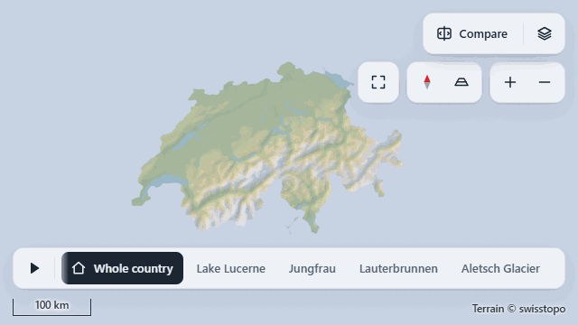
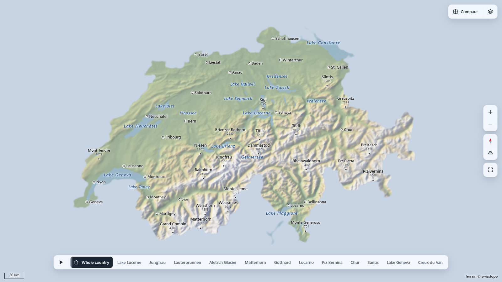
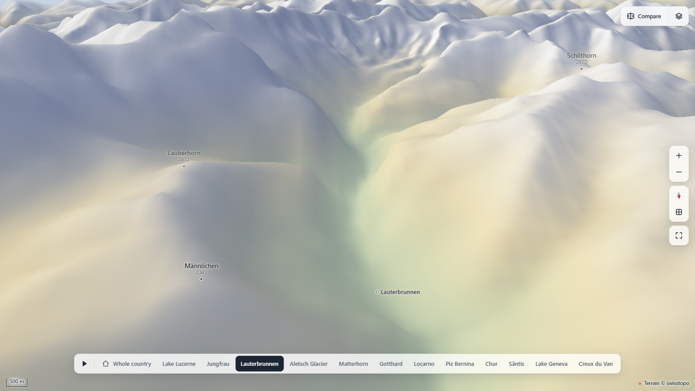
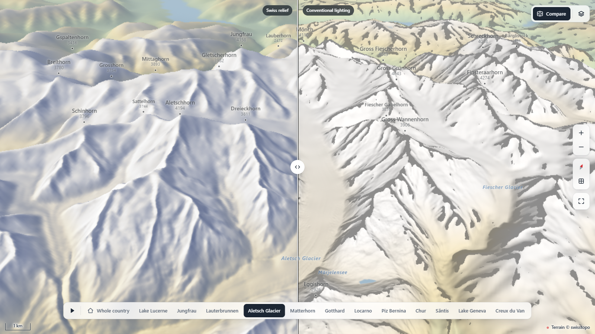
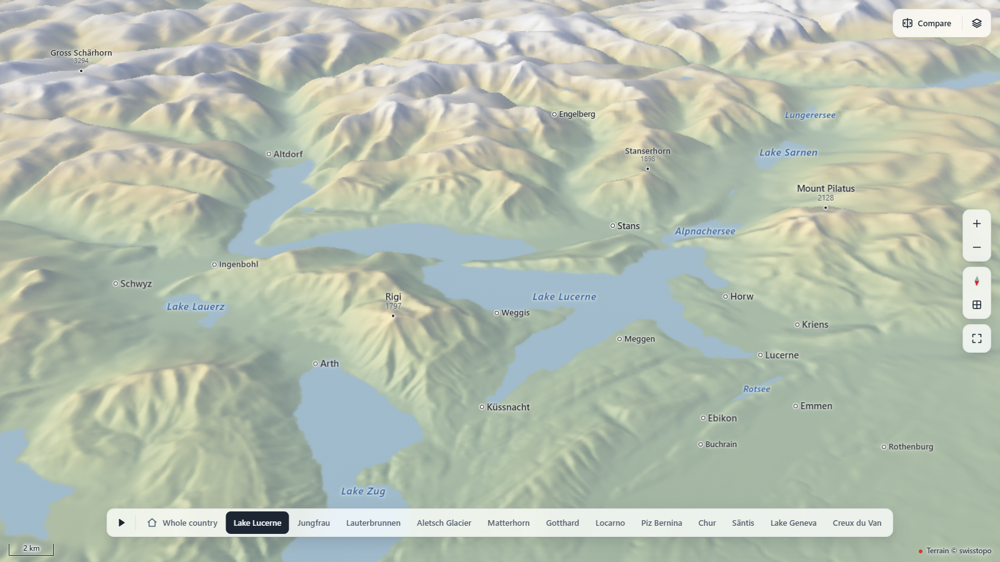
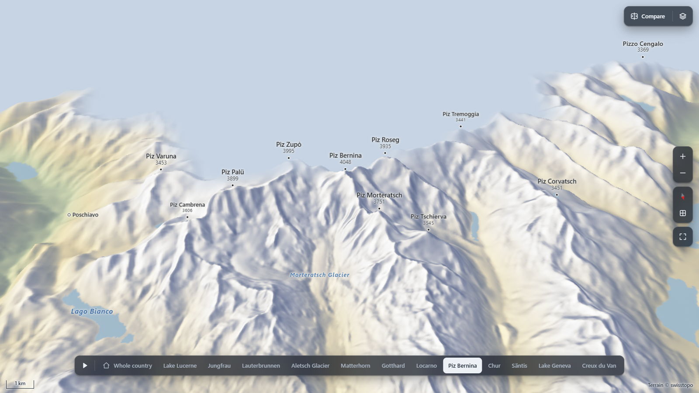

# Swiss relief, in 3D, in real time

Switzerland rendered the way Swiss maps paint it: light from the upper left,
ridges accentuated, haze with distance, and lakes in blue. Except that the
map is 3D, the light follows the camera, and you can fly anywhere in the
country at 10 m resolution. Rust + wgpu on the desktop, WebAssembly + WebGPU
in the browser, with a React component to drop on a page.



<table>
  <tr>
    <td></td>
    <td></td>
  </tr>
  <tr>
    <td></td>
    <td></td>
  </tr>
  <tr>
    <td></td>
    <td></td>
  </tr>
</table>

The right half of the comparison image is what a sun-lit terrain renderer
gives you: burnt-out faces, black shadows, and the shape of the glacier
basin gone. The left half is this project.

## Why the light moves with the camera

Hand-painted Swiss relief has a rule: the light comes from the top left of
the *sheet*. Nobody ever meant that as a compass direction; it is relative
to the reader. So in 3D the natural thing is to tie the light to the screen,
not to the world. Looking straight down you get exactly the classic map;
tilt and turn, and the light turns with you, so the terrain never goes flat
or silhouetted. The same goes for the rest of the painter's toolkit: the local
light adjustments that keep each ridge's two flanks apart, the amount of
generalization (which here is tied to how big a pixel is on the ground), and
the aerial perspective. All of it is defined relative to the view.

## Try it

You need Rust and a GPU. The data comes from swisstopo and is downloaded on
first use.

```sh
# A 41 km square of the Bernese Oberland (1.9 GB download, a few minutes):
cargo run --release -p relief-prep -- build --region jungfrau
cargo run --release -p relief-viewer -- --data data/jungfrau

# Or the whole country. Fetches the 4 m overview of all 43,627 tiles
# (10 GB, resumable, takes a few hours) and builds a 3.7 GB dataset:
cargo run --release -p relief-prep -- country
cargo run --release -p relief-viewer
```

Any square inside Switzerland works: `build --region glarus --origin-e 2700000
--origin-n 1190000`. Without any data, `relief-viewer --cone` renders a
synthetic cone, which is the quickest way to see the shading rules at work
(the north-west flank is the bright one).

For the browser, pack the dataset (520 MB of static files) and start the demo:

```sh
cargo run --release -p relief-prep -- web
cd web && npm install && npm run dev
```

### Desktop controls

| | Orbit mode | Fly mode |
| --- | --- | --- |
| Drag | move the ground (coasts) | look around |
| Right-drag | turn and tilt | look around |
| Wheel | zoom at the pointer | change speed |
| W A S D, Q E | move | move, sink / rise |
| Shift | faster | faster |

`Tab` switches orbit/fly, `C` splits the screen against conventional lighting,
`L` toggles the names, `F1` opens the lab (every parameter as a slider, debug
views, GPU timings, camera recording), `F12` saves a frame to `captures/`.

## How it works

**Preprocessing** (`relief-prep`, `relief-terrain`). swissALTI3D comes as
43,627 Cloud Optimized GeoTIFFs at 2 m. For the country build only the 4 m
overview inside each file is fetched with a range request (10 GB instead of
49 GB), then block-averaged to 10 m. From the heights: a generalized pyramid
(even `[1 3 3 1]` kernel, with ridge accentuation), per-level gradients, a
landform orientation field, a lake mask, elevation statistics, and a colour
table in OKLab. The country is a 655 km square of 10 m cells; the five finest
levels are cut into 256-texel tiles and only tiles with data are kept (7,021
at 10 m, 9,578 in all).

**Rendering** (`relief-viewer`). CDLOD quadtree with vertex morphing, heights
sampled from the pyramid so that mesh resolution never changes the shading.
Around the camera each fine level keeps an 8×8-tile window that wraps around
its texture; moving costs a row or column of tiles, never a copy. A level is
only loaded once the camera is close enough for its cells to reach pixel
size, and only used where its window is complete, so nothing pops. The
shading passes:

- camera-relative base light, rotating with a lag and a clamp so it never
  swims;
- a local light field (a 164 km square of 160 m cells around the camera)
  that rotates the light a few degrees per landform so both flanks of a
  ridge keep contrast, with hysteresis across frames;
- multi-scale exaggerated shading at a scale chosen per pixel from its
  footprint on the ground;
- elevation contrast, height fog in closed form, hypsometric tint, lakes;
- a post pass that unsharp-masks log depth into halos along depth edges.

**Streaming to the browser** (`crates/web`, `web/`). The same renderer,
compiled to wasm, drawing with WebGPU. The dataset is repacked: heights
quantized to 5 cm, predicted from neighbours, deflated. 520 MB for the
country, of which a visitor fetches 2.6 MB up front and 8–15 MB per close-up.
Phones skip the 10 m level and use smaller windows. GPUs without
`float32-filterable` (most phones) get a shader variant that filters by hand.

**Names.** A gazetteer of ~1,000 peaks, lakes, glaciers and towns, built from
Wikidata ([web/scripts/labels.mjs](web/scripts/labels.mjs)), is laid out
every frame in [labels.rs](crates/viewer/src/labels.rs): project, drop what
the view is too far out for, drop what the terrain hides (a ray marched
through the CPU-side heights), place the rest by priority without overlaps,
fade in and out. The browser draws them as HTML text over the canvas; the
desktop viewer paints them with egui.

### Layout

```
crates/terrain     dataset formats, pyramid, orientation field, lakes, colour table, web packing
crates/preprocess  relief-prep: swisstopo STAC download, mosaic, build, country, web
crates/viewer      relief-viewer: wgpu renderer, camera, labels, egui app, evaluation
crates/web         the renderer behind a JavaScript API (wasm-bindgen)
web/               React component, demo page, scripts
presets/           shading presets (the viewer opens on showcase.json)
docs/              images for this README
```

Rasters are stored south row first, positions are local metres from the
south-west corner with z up.

## Evaluation

The viewer doubles as a test bench for the method:

```sh
# one frame, no window
cargo run --release -p relief-viewer -- snapshot --view oblique_north --condition D --compare A --out compare.png
# any viewpoint: LV95 east, north, heading, distance, pitch
cargo run --release -p relief-viewer -- snapshot --orbit 2676000,1207000,170,30000,32 --preset presets/showcase.json
# every condition and ablation over 12 viewpoints and the recorded flights
cargo run --release -p relief-viewer -- evaluate --out evaluation
```

`evaluate` writes stills and CSVs with, per condition: lost relief (share of
steep slopes rendered at flat-ground brightness), vanished ridges (ridgelines
whose flanks have the same tone), flicker vs. intended relighting along the
flights (split by a half-second low-pass on tracked terrain points), and GPU
time per pass. Conditions A–E are: realistic sun lighting, a draped 2D
relief, the full shading with a world-fixed light, the full method, and a
headlight that follows the camera exactly.

A few places where the implementation ended up differing from the original
plan:
tone mapping has a soft shoulder rather than a clamp, the generalization bias
is 1.5, the local light's sign softness is 4° (a hard sign shows seams), and
the look the viewer opens with puts the light at 60°/30° instead of 45°/45°
because the default sits behind your shoulder at low pitch. Temporal AA and
the user study are not done.

## Building

Stable Rust. On Windows it builds with the `stable-x86_64-pc-windows-gnullvm`
toolchain and no Visual Studio: `.cargo/config.toml` links with Rust's own
LLD and `crates/viewer/build.rs` deals with the few system DLLs the toolchain
lacks import libraries for. MSVC, Linux and macOS ignore both.

The browser build needs the `wasm32-unknown-unknown` target, `wasm-bindgen`
at the version in `Cargo.lock`, and Node; see [web/README.md](web/README.md).
The generated bindings in `web/src/wasm` are checked in, so the web package
builds without Rust.

## Data

Elevation: [swissALTI3D](https://www.swisstopo.admin.ch/en/height-model-swissalti3d),
© swisstopo, open data with attribution. Place names: Wikidata, CC0. Neither
is in the repository; `relief-prep` downloads the elevation data and
`labels.mjs` the names.

## License

MIT.
