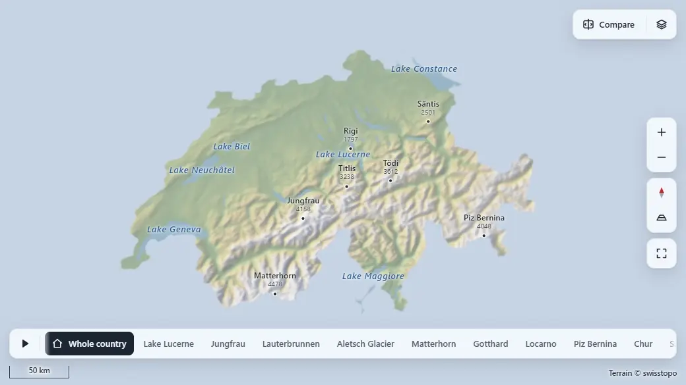
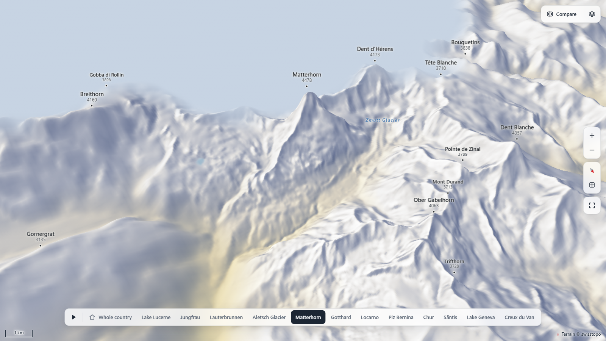
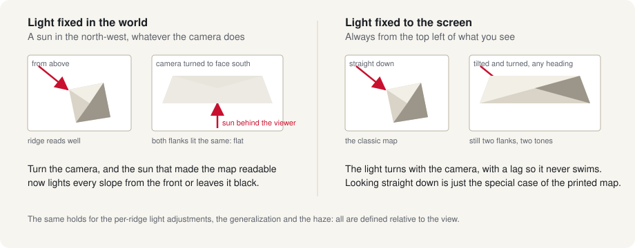
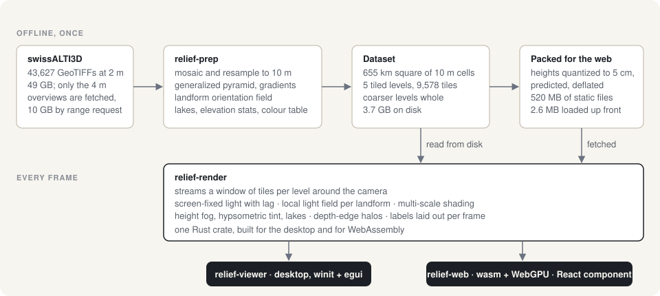
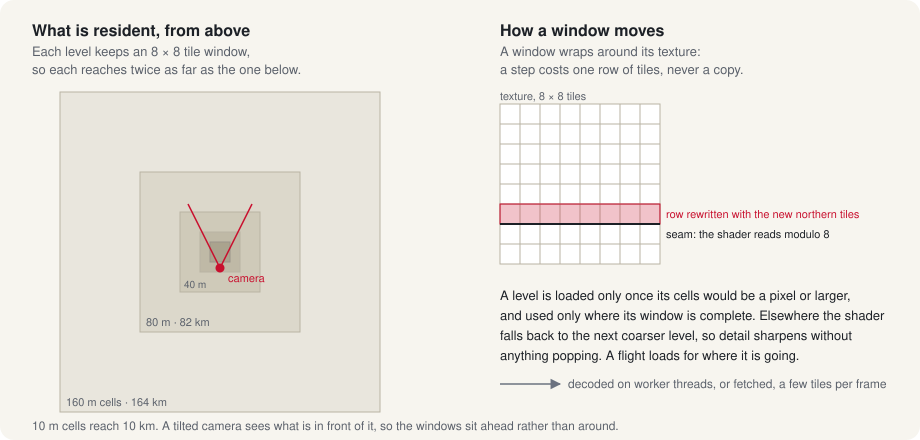

# Swiss relief, in 3D, in real time

[](https://github.com/patrickemoore/swiss-relief-3d/actions/workflows/ci.yml)

A 3D map of Switzerland shaded the way Swiss maps are painted, rendered live
at 10 m resolution. Rust and wgpu on the desktop; WebAssembly and WebGPU in
the browser, as a React component.



<table>
  <tr>
    <td></td>
    <td></td>
  </tr>
  <tr>
    <td></td>
    <td></td>
  </tr>
  <tr>
    <td></td>
    <td></td>
  </tr>
</table>

The split image shows the point of the project. On the right, a sun-lit
renderer: burnt-out faces, black shadows, the shape of the glacier basin
lost. On the left, the same terrain shaded by the rules of Swiss relief.

## What "Swiss relief" means

Swiss relief is the style of shaded relief on Swiss national maps: the
hand-painted mountains that make them look the way they do. It was worked
out in the first half of the twentieth century, above all by
[Eduard Imhof](https://en.wikipedia.org/wiki/Eduard_Imhof), and swisstopo
still draws its maps by these rules. A painter following them:

- lights the terrain from the upper left, always, whatever the real sun
  would do;
- bends that light a little from ridge to ridge, so that both flanks of
  every mountain keep their own tone and no ridge disappears;
- simplifies: small bumps are smoothed away, the main forms are drawn
  larger than life;
- uses aerial perspective: the high ground gets the strongest contrast, the
  valleys and lowlands turn paler and softer, as if seen through haze;
- colours the shadows cool and bluish and the lit slopes warm, and tints by
  elevation, from green lowlands to white summits.

The result is a picture of the land that reads at a glance, which plain
physical lighting of a height model never quite does. The
[Shaded Relief Archive](http://www.shadedreliefarchive.com/) and
[reliefshading.com](http://www.reliefshading.com/) show the originals.

## The idea here

Swiss relief maps are lit from the top left of the *sheet*. That was never a
compass direction; it is a direction relative to the reader. So in 3D the
light should be tied to the screen, not to the world:

- looking straight down, you get exactly the classic map;
- tilt and turn, and the light turns with you, so slopes never go flat or
  fall into silhouette;
- the rest of the painter's toolkit follows the view as well: the local
  adjustments that keep both flanks of a ridge apart, the amount of
  generalization (tied here to the size of a pixel on the ground), and the
  haze.



## Quick start

You need stable Rust and a GPU. Elevation data comes from swisstopo and is
downloaded on first use.

**A region** (1.9 GB download, a few minutes):

```sh
cargo run --release -p relief-prep -- build --region jungfrau
cargo run --release -p relief-viewer -- --data data/jungfrau
```

That is a 41 km square of the Bernese Oberland. Any square inside
Switzerland works: `build --region glarus --origin-e 2700000 --origin-n 1190000`.

**The whole country** (10 GB download, resumable, a few hours; the build
itself takes two minutes and 6.5 GB of memory):

```sh
cargo run --release -p relief-prep -- country
cargo run --release -p relief-viewer
```

**In the browser**: pack the dataset into static files (520 MB) and start
the demo page at <http://localhost:5173>:

```sh
cargo run --release -p relief-prep -- web
cd web && npm install && npm run dev
```

**No data at all**: `relief-viewer --cone` renders a synthetic cone. Its
north-west flank should be the bright one.

### Desktop controls

| | Orbit mode | Fly mode |
| --- | --- | --- |
| Drag | move the ground (coasts) | look around |
| Right-drag | turn and tilt | look around |
| Wheel | zoom at the pointer | change speed |
| W A S D, Q E | move | move, sink / rise |
| Shift | faster | faster |

| Key | |
| --- | --- |
| `Tab` | switch between orbit and fly |
| `C` | split the screen against conventional lighting |
| `L` | names on / off |
| `F1` | the lab: every parameter as a slider, debug views, GPU timings, camera recording |
| `F12` | save the frame to `captures/` |

The bar at the bottom flies to places, from the Matterhorn to Lake Geneva.

## How it works



### Data

swissALTI3D is 43,627 Cloud Optimized GeoTIFFs at 2 m. For the country,
`relief-prep` fetches only the 4 m overview inside each file (a range request
per tile, 10 GB instead of 49 GB) and block-averages it to 10 m. From the
heights it derives a generalized pyramid, gradients per level, a landform
orientation field, a lake mask, elevation statistics and an OKLab colour
table.

| | |
| --- | --- |
| Terrain square | 655 km, 10 m cells |
| Finest tiled levels | 5 (10 m to 160 m), 256-texel tiles |
| Tiles with data | 7,021 at 10 m, 9,578 in all |
| Dataset on disk | 3.7 GB |
| Packed for the web | 520 MB |

### Streaming

Each fine level keeps an 8×8-tile window around the camera that wraps
around its texture, so moving costs a row or column of tiles, never a copy.
A level is loaded only once the camera is close enough for its cells to
reach pixel size, and used only where its window is complete; elsewhere the
shader falls back to the next coarser level, so nothing pops. Flights load
for their destination, not for what passes underneath.



### Shading

Heights are sampled from the pyramid rather than baked into the mesh, so mesh
resolution never changes the look. Per frame:

1. A base light fixed to the screen, rotating towards new camera headings
   with a lag and a clamp so it never swims.
2. A local light field around the camera (a 164 km square at 160 m) that
   turns the light a few degrees per landform, keeping both flanks of every
   ridge apart, with hysteresis across frames.
3. Multi-scale exaggerated shading at a scale chosen per pixel from its
   footprint on the ground.
4. Elevation contrast, height fog in closed form, hypsometric tint, lakes.
5. A post pass that turns log depth into halos along depth edges.

### Browser

The same renderer compiled to wasm, drawing with WebGPU. The dataset is
repacked (heights quantized to 5 cm, predicted from neighbours, deflated):
a visitor fetches 2.6 MB up front and 8–15 MB per close-up. Phones skip the
10 m level and use smaller windows; GPUs without `float32-filterable`, which
is most phones, get a shader that filters by hand. Frames are drawn only
when something changed.

### Names

About 1,000 peaks, lakes, glaciers and towns from Wikidata, built by
[tools/labels.mjs](tools/labels.mjs) and embedded in the renderer. Each
frame, [labels.rs](crates/render/src/labels.rs) projects them, keeps those
the view is close enough for, drops those the terrain hides (a ray marched
through the CPU-side heights), places the rest by priority without overlaps,
and fades them in and out. The browser draws them as HTML text over the
canvas; the desktop viewer paints them with egui.

## Repository layout

The reusable parts and the demos around them are kept apart.

```
Reusable
  crates/terrain     dataset formats, pyramid, orientation field, lakes, colour table, web packing
  crates/render      renderer, camera, shading parameters, places, labels (desktop and wasm)
  crates/web         relief-render behind a JavaScript API (wasm-bindgen)
  web/src            the React component, published as the `swiss-relief` package
  tools/             builds the gazetteer that relief-render embeds

Tools and demos
  crates/preprocess  relief-prep: swisstopo download, mosaic, build, country, web packing
  crates/viewer      relief-viewer: the desktop window, lab panel, frame dumps, evaluation
  web/demo           the demo page around the component, with its static files
  web/scripts        screenshot and recording scripts for the demo
  presets/           shading presets for the desktop lab
  docs/              images for this README
```

Conventions: rasters are stored south row first; positions are local metres
from the south-west corner of the terrain, z up.

## Evaluation

The viewer doubles as a test bench:

```sh
# one frame, no window
cargo run --release -p relief-viewer -- snapshot --view oblique_north --condition D --compare A --out compare.png

# any viewpoint: LV95 east, north, heading, distance, pitch
cargo run --release -p relief-viewer -- snapshot --orbit 2676000,1207000,170,30000,32 --preset presets/showcase.json

# every condition over 12 viewpoints and the recorded flights; writes stills and CSVs
cargo run --release -p relief-viewer -- evaluate --out evaluation
```

| Condition | |
| --- | --- |
| A | realistic sun, shadows and haze |
| B | a 2D Swiss relief draped over the terrain |
| C | this method with a world-fixed light |
| D | this method |
| E | this method with a headlight that follows the camera exactly |

The metrics per condition: lost relief (steep slopes rendered at flat-ground
brightness), vanished ridges (ridgelines whose flanks have the same tone),
flicker along the flights (separated from intended relighting by a
half-second low-pass on tracked terrain points), and GPU time per pass.

A few choices worth knowing about: tone mapping has a soft shoulder rather
than a clamp, because flat ground is already light and a clamp turns every
lit slope the same white; the generalization bias is 1.5; the local light's
sign softness is 4°, since a hard sign shows seams between landforms; and
the viewer opens with the light 60° left of screen-up and 30° above the
image plane rather than 45°/45°, which sits behind your shoulder at low
pitch and lights most slopes frontally. There is no temporal anti-aliasing
yet, and the conditions have been measured but not put in front of people.

## Prior work

None of the cartography here is new; the contribution is doing it per frame,
relative to a moving camera, over a whole country.

- Imhof, E. *Cartographic Relief Presentation*. De Gruyter, 1982 (German
  original 1965). The rules this project follows: illumination from the
  upper left, local adjustment of the light, generalization, aerial
  perspective, and the colours of shadow and light.
- Brassel, K. "A model for automatic hill-shading." *The American
  Cartographer* 1(1), 1974. The first automated Swiss-style shading, with
  the light turned locally per landform and contrast falling with elevation.
- Jenny, B. "An interactive approach to analytical relief shading."
  *Cartographica* 38(1–2), 2001. Local light direction and weight as
  something the cartographer edits region by region.
- Veronesi, F. and Hurni, L. "Changing the light azimuth in shaded relief
  representation by clustering aspect." *The Cartographic Journal* 51(4),
  2014. Deriving the local light rotation from the terrain itself, which is
  what the orientation field and the local light pass do here.
- Marston, B. E. and Jenny, B. "Improving the representation of major
  landforms in analytical relief shading." *IJGIS* 29(7), 2015, and
  Leonowicz, A. M., Jenny, B. and Hurni, L. "Automated reduction of visual
  complexity in small-scale relief shading." *Cartographica* 45(1), 2010.
  Shading a generalized terrain to keep the large forms: the pyramid and the
  per-pixel choice of scale come from here.
- Jenny, B. and Patterson, T. "Aerial perspective for shaded relief."
  *Cartography and Geographic Information Science* 48(1), 2021. The
  elevation-dependent contrast and haze.
- Jenny, B. et al. "Cartographic relief shading with neural networks." *IEEE
  TVCG* 27(2), 2021. A different route to the same look, trained on
  swisstopo's hand-painted relief.
- Losasso, F. and Hoppe, H. "Geometry clipmaps." *SIGGRAPH* 2004, and
  Strugar, F. "Continuous distance-dependent level of detail for rendering
  heightmaps." *Journal of Graphics, GPU, and Game Tools* 14(4), 2009. The
  nested wrapping windows of terrain and the morphing quadtree mesh.
- van Wijk, J. J. and Nuij, W. A. A. "Smooth and efficient zooming and
  panning." *IEEE InfoVis* 2003. The shape of the flights between places.
- Imhof, E. "Positioning names on maps." *The American Cartographer* 2(2),
  1975, and Been, K., Daiches, E. and Yap, C. "Dynamic map labeling." *IEEE
  TVCG* 12(5), 2006. Where names go, and what must not happen to them while
  the view moves: no popping, no flicker, no sliding.
- Ottosson, B. "A perceptual color space for image processing." 2020. The
  OKLab space the colour table is interpolated in.

## Building

Stable Rust on Linux, macOS and Windows. On Windows it also builds with the
`stable-x86_64-pc-windows-gnullvm` toolchain and no Visual Studio:
`.cargo/config.toml` links with Rust's own LLD, and the build scripts of
`relief-render` and `relief-viewer` handle the few system DLLs that
toolchain lacks import libraries for.

The browser build needs the `wasm32-unknown-unknown` target, `wasm-bindgen`
at the version in `Cargo.lock`, and Node; see [web/README.md](web/README.md).
The generated bindings in `web/src/wasm` are checked in, so the web package
builds without Rust.

## Data and licence

Elevation: [swissALTI3D](https://www.swisstopo.admin.ch/en/height-model-swissalti3d),
© swisstopo, open data with attribution. Place names: Wikidata, CC0. Neither
is in the repository.

Code: MIT.
